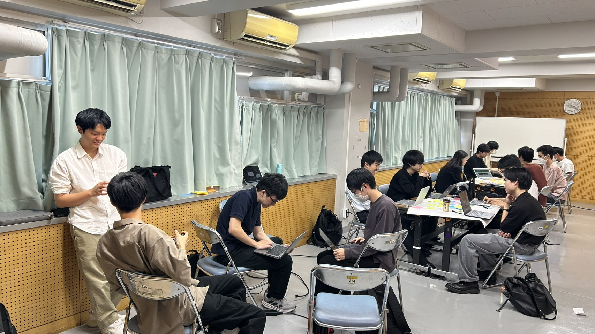

ut.code(); は、10月17日(土)に第77回駒場祭のプロジェクトキックオフを行いました。

ut.code(); では毎年、駒場祭で部員たちが作成したゲームやアプリケーションなどを来場者の方に実際にパソコン上で体験していただく展示を行っております。今回の発足会では4チームに分かれてアイデア出しをしました。

発足会ではまずチームごとにアイデアを出しあい、多種多様なゲームの案が挙がりました。その中から一人一案を試作してほかの人の物と比較を行いました。

これからの各チームごとのミーティングで発足するプロジェクトを決定していきます！
次の駒場祭では、ut.code(); の企画「あなたのためのプログラミング」に是非足を運んでみてください！
